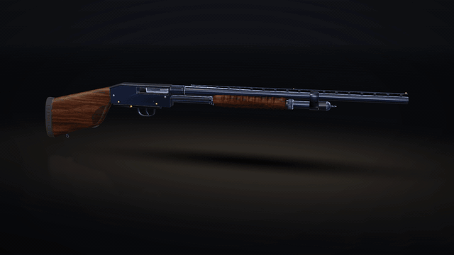

# Ironwood Mk I

An interactive 3D exploded view of a walnut-stocked pump-action shotgun, built entirely in code with three.js. No models or textures are loaded: every part, material and shader is procedural, and the page is one self-contained HTML file.

**Live:** https://simsi2027.github.io/ironwood/ · **Film:** [docs/ironwood.mp4](docs/ironwood.mp4) (12 s, 1080p60)

- **Take it apart.** 8 assemblies, 61 parts: the explode slider splits the assemblies along the bore, then fans out each one's parts, with a labelled parts-diagram view at full explode.
- **Fire and pump it.** One hand-keyed clock: trigger, hammer, firing pin, primer, the shot down the bore, a muzzle bloom, recoil; then the pump unlocks, ejects the spent shell, lifts and chambers a fresh one, with x-ray on the parts that move.
- **Always framed.** One camera rule for every state: the whole gun, an assembly, or the moving part with the gun around it fills 80% of the free screen, at any window size; idle, it sways slowly about a three-quarter view.

## Controls

- **Drag** to orbit, **scroll** or pinch to zoom.
- **Explode** slider: take it apart and put it back.
- **01-08** pills: fly to an assembly; the rest dim.
- **Hover** a part (or **tap** on touch) for its name; a tap pins the card.
- **FIRE · PUMP · FULL**: run the cycle at 1x, 0.25x, 0.1x or 0.05x; step frames, scrub the split FIRE / PUMP track, or **drag the forend** to pump by hand.
- **Tour**: a 24 s guided run; any input hands control back.
- **?** in the header lists these.

## Quality tiers

| Tier | Anti-aliasing | Pixel ratio | Shadows | Extras |
| --- | --- | --- | --- | --- |
| HIGH | 8x MSAA + SMAA | up to 2 | 4096 soft (VSM) | SSAO, bloom, reflection 1024 |
| MED | 4x MSAA + SMAA | up to 1.5 | 1024 soft (VSM) | bloom, reflection 512 |
| LOW | SMAA | 1 | 1024 soft (VSM) | reflection off on phones |

HIGH starts on NVIDIA RTX/GTX, Radeon RX, Arc and Apple M-series; phones start LOW; everything else MED. The header toggle remembers a choice; `?q=high|med|low` forces one. If the render work of drawn frames stays over 20 ms for a second, the page steps down by itself (SSAO, reflection, shadow map, pixel ratio, shadows), cross-fading each step.

## Credits

- [three.js](https://threejs.org/)
- [Nyxera0x/cutaway](https://github.com/Nyxera0x/cutaway), the cutaway skill this project was built and filmed with.
- Barlow Condensed and JetBrains Mono fonts, embedded in the build.

## License

MIT
