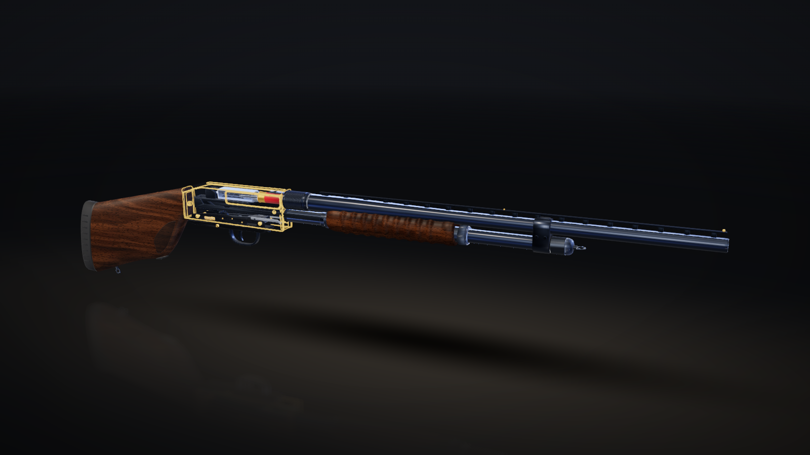

# Ironwood Mk I

An interactive 3D exploded view of a walnut-stocked pump-action shotgun, built entirely in code with three.js. No models or textures are loaded: every part, material and shader is procedural, and the built page is one self-contained HTML file.

**Live:** https://simsi2027.github.io/ironwood/

Firing and pumping are one hand-keyed clock t in two segments. FIRE (0-0.30): the trigger rotates back, the hammer falls on the firing pin, the primer sparks, the hull glows, the wad and shot column run the bore, the muzzle flashes (with a 0.1 s light, a 60-pellet shot cloud and a smoke puff) and the gun recoils 1.5 cm with a 2 degree muzzle rise. PUMP (0.30-1): the forend, action bars and bolt run back 7.5 cm, re-cocking the hammer; the shell pivots out of the port on its sill, flies a 30 x 12 cm arc, bounces, rolls and fades (spent only if FIRE ran, clean otherwise); a fresh shell rises on the elevator and is chambered; the trigger resets as the bolt locks. X-ray and the camera follow the phase.

## Controls

- **Drag** to orbit, **scroll** or pinch to zoom.
- **Explode** slider takes the rifle apart and puts it back together.
- **Hover** a part (or **tap** on touch) to see its name and assembly. A tap pins the card, and a tap on empty space clears it.
- **Cycle** panel: **FIRE** plays the shot (clock 0-0.30) and holds at the end of the recoil, **PUMP** plays the action (0.30-1: eject, lift, feed, lock), **FULL** plays both end to end. One scrubber split into the FIRE and PUMP segments (the active one widens and shows its tick labels); play/pause, step one frame (1/240 s) with the arrow buttons, speeds 1x, 0.25x, 0.1x, 0.05x; the readout shows seconds and the frame number. The camera follows the phase until you orbit, and when playback reaches Locked (back to Ready) it eases back to the default framing over 0.8 s and any dimming clears. On a phone the panel is one row (FIRE, PUMP, FULL, scrubber, readout); the chevron opens play, steps, ticks and speeds.
- **Drag the forend** along the barrel to scrub the PUMP segment by hand (orbit pauses while you hold it).
- **Quality** toggle in the header, **HIGH / MED / LOW**: HIGH is a 4096 shadow map, SSAO, reflection at 1024 and DPR up to 2; MED (the start for everything but a detected discrete GPU) is a 1024 shadow map, no SSAO, reflection at 512 and DPR up to 1.25; LOW (the start on phones) draws with no post-processing at DPR 1. HIGH is chosen automatically for NVIDIA RTX/GTX, Radeon RX, Arc and Apple M-series; a tier is remembered only when you click the toggle, or force one with `?q=high|med|low`. If the render work of the frames it draws (GPU time of the draw) stays over 20 ms for a second the page steps down by itself: SSAO, reflection, shadow map 1024, DPR 1, shadows off.
- **Tour** plays a 24 s guided sequence (the FULL clock at 0.25x, then each assembly, explode, reassemble). Any input hands control back to you.

## Credits

- [three.js](https://threejs.org/)
- [Nyxera0x/cutaway](https://github.com/Nyxera0x/cutaway), the cutaway skill this project was built with.
- Barlow Condensed and JetBrains Mono fonts, embedded in the build.

## License

MIT
